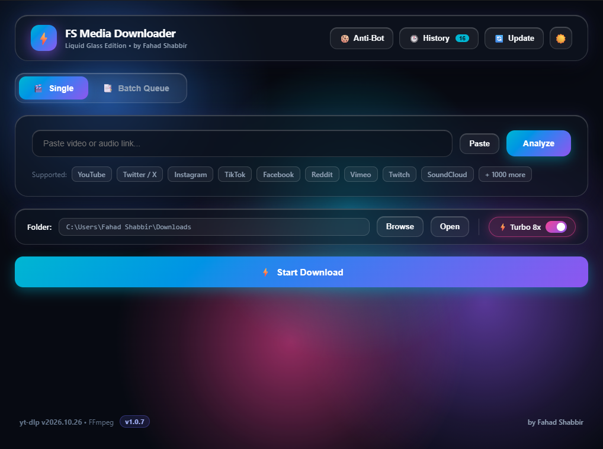
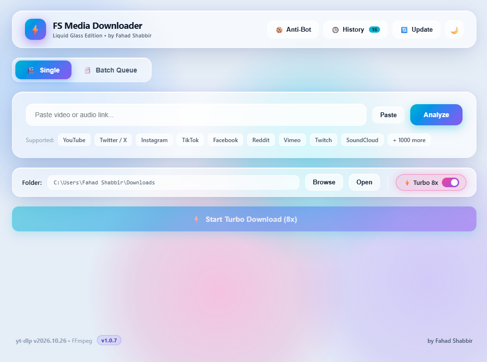
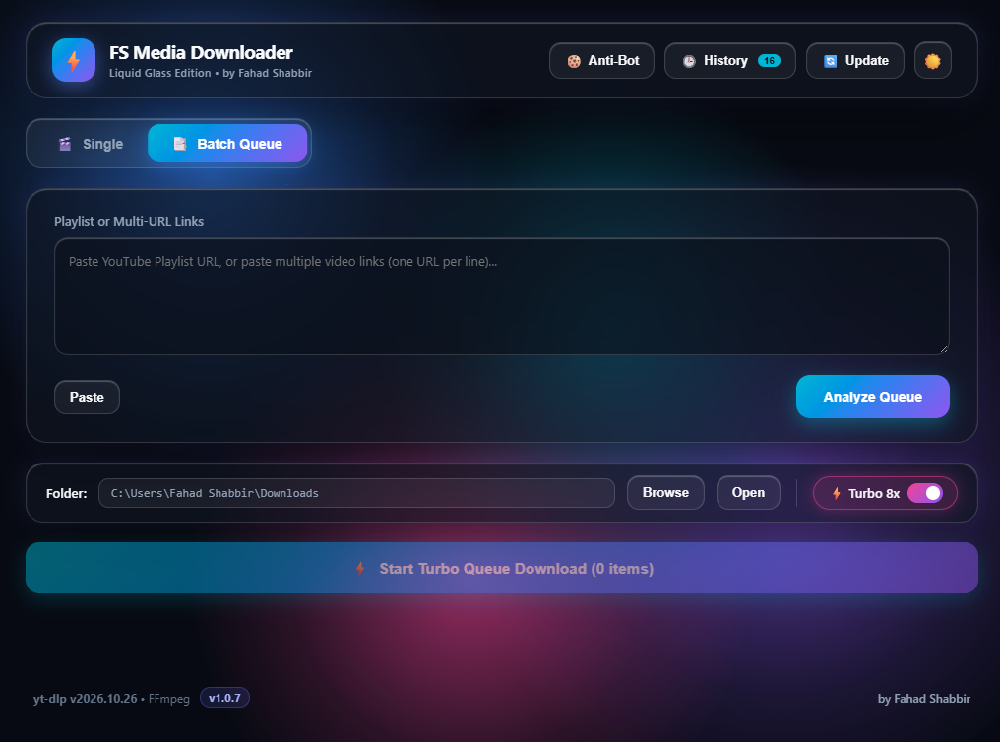
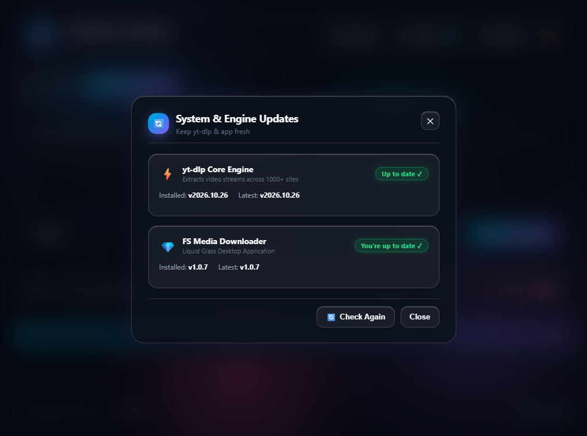

# FS Media Downloader

[](https://github.com/Fahad-Shabbir/FS-Media-Downloader/releases/latest)
[](https://github.com/Fahad-Shabbir/FS-Media-Downloader/releases)
[](LICENSE)


Download video and audio from YouTube, X (Twitter), Instagram, TikTok, Facebook, Reddit, Vimeo, Twitch, SoundCloud and 1,000+ other sites, in a Windows app with a liquid-glass interface. Paste a link, pick a quality, press **Start Download**.

[](https://github.com/Fahad-Shabbir/FS-Media-Downloader/releases/latest)

## Download

Get the latest installer from the [Releases page](https://github.com/Fahad-Shabbir/FS-Media-Downloader/releases/latest): `FS_Media_Downloader_Setup_vX.Y.Z.exe`.

Run it and follow the wizard. It installs to your user profile, so it needs no administrator rights. No Python needed.

## Features

- **Many sites.** Everything yt-dlp supports, 1,000+ sites.
- **Single link.** Preview card with thumbnail, duration and platform. Choose video up to 4K / 2K / 1080p, MP3 (320 kbps), M4A or lossless WAV. File-size badges show on each quality.
- **Batch queue.** Paste a playlist or a list of links (one per line, mixed sites are fine) into one queue.
- **Turbo 8x.** Parallel fragment downloads for faster speeds.
- **Pause, resume, cancel.** Cancelling cleans up partial files.
- **Anti-Bot.** Import a `cookies.txt` (or use your browser's cookies) to get past "Sign in to confirm you're not a bot".
- **History.** Recent downloads in a drawer, with actions after each download.
- **Clip trimmer.** Download just part of a video.
- **Smart clipboard.** Detects a copied link automatically.
- **Safe updates.** One-click updates for the yt-dlp engine and the app itself. Downloads are SHA-256 verified.
- **Light and dark mode.** Frosted glass look, animated background, wave progress bar.

## Screenshots

| | |
|---|---|
| [](docs/home-light.png)<br>**Light mode** | [](docs/home-dark.png)<br>**Dark mode** |
| [](docs/batch-queue.png)<br>**Batch queue** | [](docs/updates.png)<br>**Updates** |

## Quick start

1. Paste a link and press **Analyze**.
2. Pick video or audio, and the quality.
3. Choose a folder, then press **Start Download**.

For playlists or many links, switch to **Batch Queue**.

## Run from source

Needs Windows and Python 3.

```powershell
git clone https://github.com/Fahad-Shabbir/FS-Media-Downloader.git
cd FS-Media-Downloader
pip install -r requirements.txt
python app.py
```

## Build it yourself

| Goal | Command | Output |
|---|---|---|
| Installer (recommended) | `build_installer.bat` (needs [Inno Setup 6](https://jrsoftware.org/isinfo.php)) | `installer_output\FS_Media_Downloader_Setup_vX.Y.Z.exe` |
| Raw executable only | `build_exe.bat` | `dist\` |

The raw executable is a build step for the installer and is not published on its own.

## Where things are

| | Installed | From source |
|---|---|---|
| App | `%LOCALAPPDATA%\Programs\FS Media Downloader` | the cloned folder |
| Downloads | the folder you pick in the app (default: your Downloads) | same |

## Release history

See [RELEASE_NOTES.txt](RELEASE_NOTES.txt).

## Credits and license

Built on [yt-dlp](https://github.com/yt-dlp/yt-dlp) and FFmpeg. Made by [Fahad Shabbir](https://github.com/Fahad-Shabbir). Released under the [MIT License](LICENSE).

Only download content you have the right to download.
